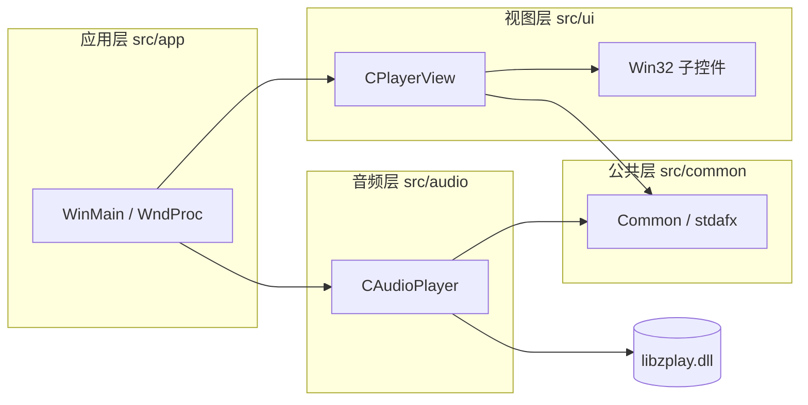
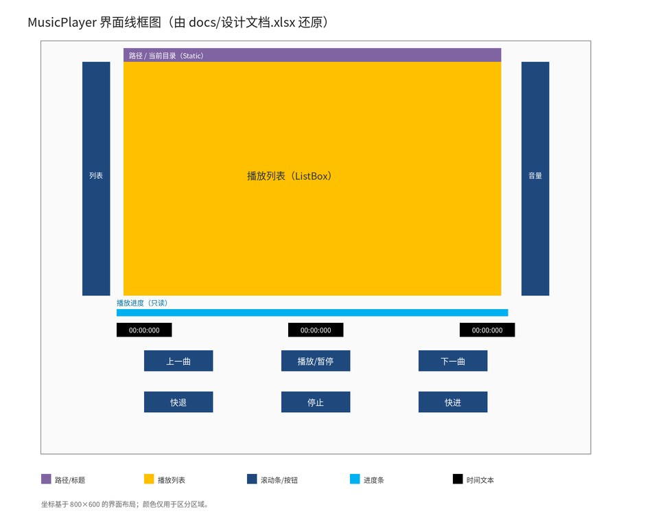
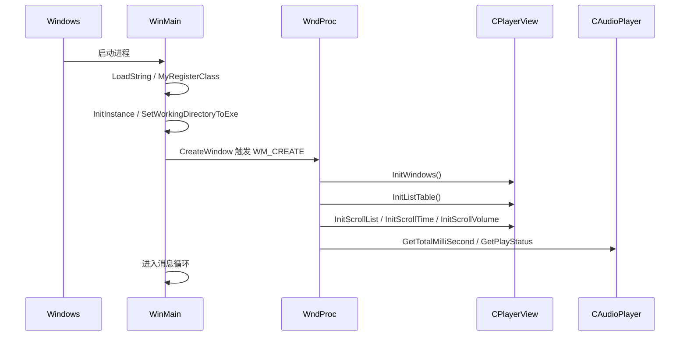
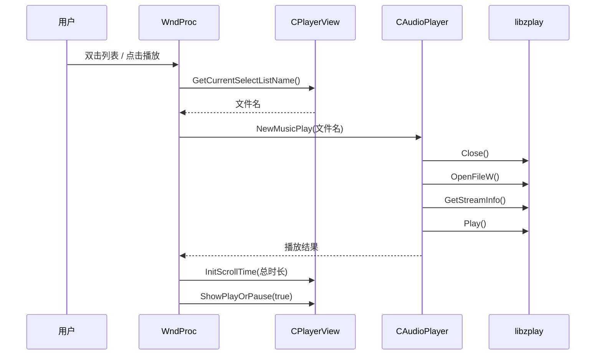
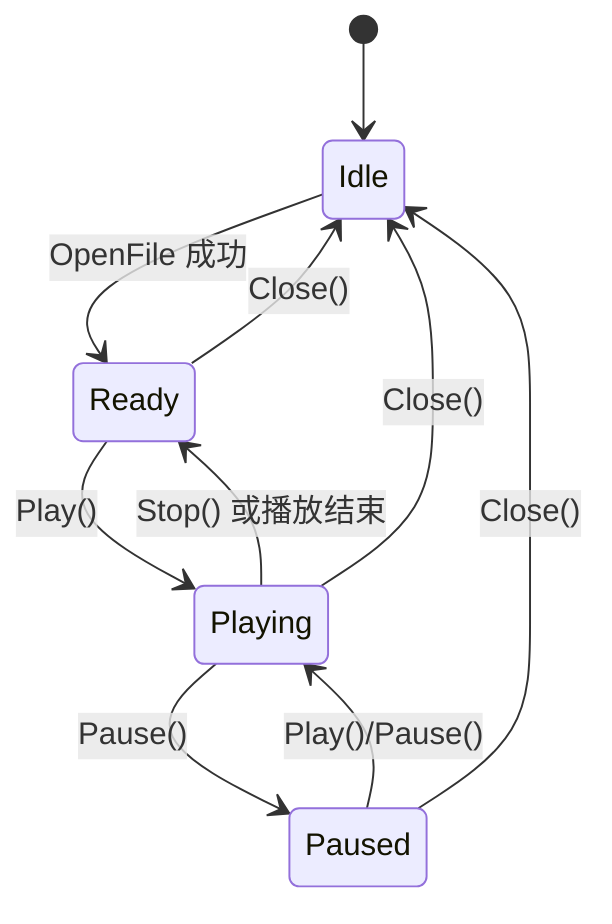

# MusicPlayer 设计文档

| 项目 | 内容 |
|---|---|
| 项目名称 | MusicPlayer |
| 文档版本 | 1.1.0 |
| 对应代码 | `v1.1.0` / VS 18 (v145) |
| 最后更新 | 2026-11-25 |
| 维护者 | kaisawind <wind.kaisa@gmail.com> |
| 变更历史 | [CHANGELOG.md](../CHANGELOG.md) |
| 设计文档 | `docs/设计文档.md` |
| 原设计文件 | `设计文档.xlsx`（单元格色块线框图，已转换并移除） |

> 说明：原始设计文件 `设计文档.xlsx` 没有文字单元格，而是用彩色单元格拼出的 UI 线框图。
> 该文件已转换为本文档和 [`images/ui-layout.png`](images/ui-layout.png)，不再保留 Excel 源文件。
> 本文档结合当前代码补充了模块、流程、状态和构建说明。

## 目录

1. [项目概述](#1-项目概述)
2. [总体架构](#2-总体架构)
3. [界面设计](#3-界面设计)
4. [模块设计](#4-模块设计)
5. [关键流程](#5-关键流程)
6. [数据结构与状态](#6-数据结构与状态)
7. [构建与运行](#7-构建与运行)
8. [已知限制与后续改进](#8-已知限制与后续改进)
9. [附录](#9-附录)

---

## 1. 项目概述

### 1.1 背景与目标

MusicPlayer 是一个用 Win32 API 编写的桌面音乐播放器，最初是 2013 年的 C++ 入门学习项目。
项目通过封装 [libzplay](https://libzplay.sourceforge.net/) 完成音频解码与播放，重点练习：

- Win32 窗口、消息循环和子控件编程
- GDI 文本绘制
- C++ 类的封装与单例
- 第三方动态库的集成
- Visual Studio 工程和 CMake 构建

### 1.2 功能范围

- 列出程序所在目录下的 `*.MP3` / `*.WAV` 文件
- 播放、暂停、停止
- 上一曲、下一曲
- 快进、快退（±5 秒）
- 音量调节
- 显示开始时间、当前播放时间、总时间
- 菜单、按钮、列表框双击三种操作方式
- 播放结束后自动停止并恢复按钮状态

### 1.3 技术栈

| 层次 | 技术 |
|---|---|
| 语言 | C++11 |
| 界面 | Win32 API、ListBox、ScrollBar、Button、Static |
| 绘制 | GDI `TextOut` |
| 音频 | libzplay 2.02（32 位 DLL） |
| Windows 构建 | Visual Studio 18 (v145)、MSBuild |
| 跨平台构建 | CMake 3.20+、可选 zig cc 交叉编译 |
| 资源 | `.rc` 资源脚本、图标、菜单、对话框 |

### 1.4 非目标

当前版本不包含：

- 在线音乐、流媒体
- 歌曲元数据、封面、歌词
- 播放列表持久化
- 均衡器、音效 UI
- 皮肤、主题、DPI 自适应
- 单元测试和自动化 UI 测试

---

## 2. 总体架构

### 2.1 模块划分



### 2.2 模块职责

| 模块 | 文件 | 职责 |
|---|---|---|
| 应用模块 | `src/app/MusicPlayer.cpp/.h` | 入口、窗口类、消息循环、菜单/按钮/列表分发、定时器、工作目录 |
| 音频模块 | `src/audio/AudioPlayer.cpp/.h` | 封装 libzplay，维护播放状态和文件状态 |
| 视图模块 | `src/ui/PlayerView.cpp/.h` | 创建/更新子控件，处理列表、滚动条、时间显示 |
| 公共模块 | `src/common/Common.h`、`src/common/Range.h` | 公共常量；索引和区间的夹紧函数 |
| 测试 | `tests/test_range.cpp` | 列表索引、音量区间夹紧的单元测试 |
| 预编译头 | `src/common/stdafx.cpp/.h`、`targetver.h` | Windows/CRT 头文件、PCH |
| 资源 | `src/res/MusicPlayer.rc`、`resource.h`、图标 | 菜单、快捷键、关于对话框、字符串、图标 |
| 第三方库 | `third_party/libzplay/` | 32 位 `libzplay.dll`、导入库和头文件 |

### 2.3 依赖关系

- `app` 依赖 `ui` 和 `audio`
- `ui` 依赖 Win32 API 和 `common`
- `audio` 依赖 libzplay 和 `common`
- `common` 不依赖业务模块
- 依赖方向单向，没有循环依赖

### 2.4 设计说明

- 程序采用 **Win32 消息驱动**，没有使用 MFC。
- `CAudioPlayer` 是单例，负责隔离 libzplay 的 C++ 接口。
- `CPlayerView` 是轻量的视图辅助类：它不保存控件句柄，而是通过控件 ID 调用 `GetDlgItem`；
  它在每条消息处理时临时构造，真正持久的 UI 状态保存在 Win32 子控件中。
- 音频状态和文件状态集中放在 `CAudioPlayer` 的 `PlayStatus` / `FileStatus` 中，视图层只读。

---

## 3. 界面设计

### 3.1 窗口

- 窗口标题：`音乐播放器`（资源字符串 `IDS_APP_TITLE`）
- 初始客户区：800 × 600（按系统 DPI 缩放）
- 最小尺寸：640 × 480（按 DPI 缩放）
- 窗口样式：`WS_OVERLAPPED | WS_CAPTION | WS_SYSMENU | WS_MINIMIZEBOX | WS_MAXIMIZEBOX | WS_THICKFRAME`
- DPI：优先 Per-Monitor V2，旧系统回退到 System DPI Aware；`WM_DPICHANGED` 时重新布局
- 主窗口没有使用对话框模板，所有子控件在 `WM_CREATE` 中动态创建

### 3.2 线框图



> 上图由原始 `设计文档.xlsx` 的彩色单元格还原，颜色仅用于区分区域，不代表最终控件配色。

### 3.3 布局明细

下表是 96 DPI、800×600 客户区下的设计基准坐标。运行时按 DPI 缩放，
路径栏、播放列表、滚动条和按钮会随窗口拉伸；时间文本会重新居中。

| 编号 | 区域 | 坐标 (x, y) | 尺寸 (w × h) | 实现 | 线框颜色 |
|---|---|---|---|---|---|
| 1 | 路径/当前目录 | 120, 10 | 550 × 20 | `Static` / `STATIC_LISTPATH_ID` | 紫 `#8064A2` |
| 2 | 播放列表 | 120, 30 | 550 × 340 | `ListBox` / `LIST_TABLE_ID` | 橙 `#FFC000` |
| 3 | 列表滚动条 | 60, 30 | 40 × 340 | `ScrollBar` / `SCROLL_LIST_ID` | 深蓝 `#1F497D` |
| 4 | 音量滚动条 | 700, 30 | 40 × 340 | `ScrollBar` / `SCROLL_VOLUME_ID` | 深蓝 `#1F497D` |
| 5 | 播放进度条 | 110, 390 | 570 × 10 | `ScrollBar` / `SCROLL_TIME_ID` | 青 `#00B0F0` |
| 6 | 开始时间 | 110, 410 | 80 × 20 | `TextOut` | 黑 `#000000` |
| 7 | 当前时间 | 360, 410 | 80 × 20 | `TextOut` | 黑 `#000000` |
| 8 | 总时间 | 610, 410 | 80 × 20 | `TextOut` | 黑 `#000000` |
| 9 | 上一曲 | 150, 450 | 100 × 30 | `Button` / `BUTTON_PRESONG_ID` | 深蓝 `#1F497D` |
| 10 | 播放/暂停 | 350, 450 | 100 × 30 | `Button` / `BUTTON_PLAYPAUSE_ID` | 深蓝 `#1F497D` |
| 11 | 下一曲 | 550, 450 | 100 × 30 | `Button` / `BUTTON_NEXTSONG_ID` | 深蓝 `#1F497D` |
| 12 | 快退 | 150, 510 | 100 × 30 | `Button` / `BUTTON_REW_ID` | 深蓝 `#1F497D` |
| 13 | 停止 | 350, 510 | 100 × 30 | `Button` / `BUTTON_STOP_ID` | 深蓝 `#1F497D` |
| 14 | 快进 | 550, 510 | 100 × 30 | `Button` / `BUTTON_FF_ID` | 深蓝 `#1F497D` |

### 3.4 交互行为

| 操作 | 行为 |
|---|---|
| 双击列表项 | 取当前选中项文件名，关闭旧文件，打开并播放 |
| 上一曲 | 选中索引减一（最小 0），播放该曲目 |
| 下一曲 | 选中索引加一（到末尾后保持最后一项并重播），播放该曲目 |
| 播放/暂停 | 若选中文件与当前文件不同，先打开新文件；否则切换暂停/继续 |
| 停止 | 停止播放，按钮文字恢复为“播放” |
| 快退 | 从当前位置后退 5 秒 |
| 快进 | 从当前位置前进 5 秒 |
| 列表滚动条 | 上下滚动播放列表；支持鼠标滚轮 |
| 音量滚动条 | 设置左右声道音量（0–100） |
| 进度条 | 拖动/点击跳转到对应秒数 |
| 菜单“文件 → 打开” | 选择 MP3/WAV，切换工作目录并播放 |
| 菜单“播放模式 → 顺序/单曲循环/列表循环/随机” | 设置播放结束后的切歌方式 |
| 菜单“文件 → 退出” | 关闭窗口 |
| 菜单“编辑 → 播放/暂停/停止/上一曲/下一曲” | 与按钮行为一致 |
| 菜单“帮助 → 关于” | 打开关于对话框 |
| 定时器（1 秒） | 更新当前时间；播放结束后按播放模式切歌 |

### 3.5 文件列表与工作目录

- 程序启动时调用 `SetWorkingDirectoryToExe()`，把当前工作目录切换到 exe 所在目录。
- 列表框通过 `LB_DIR` 加载 `*.MP3` 和 `*.WAV`，并使用 `LBS_SORT` 排序。
- 因此把音乐文件放到 `MusicPlayer.exe` 同目录即可在列表中看到。
- 列表项只保存文件名，不保存完整路径；播放时在当前目录下打开。
- “文件 → 打开”选择其它目录的文件后，会把工作目录切到该文件所在目录，
  重新填充列表并选中该文件。
- 退出或打开新目录时把当前目录写入 exe 同目录的 `MusicPlayer.ini`；下次启动自动恢复。

### 3.6 原始线框色块映射

| 颜色 | RGB | 含义 |
|---|---|---|
| 紫色 | `#8064A2` | 路径/标题区域 |
| 橙色 | `#FFC000` | 播放列表主区域 |
| 深蓝 | `#1F497D` | 左右滚动条、底部按钮 |
| 青色 | `#00B0F0` | 播放进度条 |
| 黑色 | `#000000` | 三个时间文本区域 |
| 白色 | — | 背景和控件之间的间距 |

---

## 4. 模块设计

### 4.1 应用模块

文件：`src/app/MusicPlayer.cpp`、`src/app/MusicPlayer.h`

#### 职责

- 程序入口 `_tWinMain`
- 注册窗口类、创建主窗口、消息循环
- 分发菜单、按钮、列表框和定时器消息
- 维护窗口句柄、标题和窗口类名

#### 主要函数

| 函数 | 说明 |
|---|---|
| `_tWinMain` | 加载字符串、注册窗口类、初始化实例、进入消息循环 |
| `MyRegisterClass` | 注册主窗口类，设置图标、光标、背景和菜单 |
| `InitInstance` | 保存实例句柄，切换工作目录，创建 800×600 主窗口 |
| `WndProc` | 主窗口消息处理 |
| `MenuProc` | 菜单命令分发 |
| `ButtonProc` | 按钮命令分发 |
| `ListBoxProc` | 列表框双击处理 |
| `TimerProc` | 每秒更新播放时间和状态 |
| `GetMouseDeltaPerLine` | 读取系统滚轮行数，计算滚动步长 |
| `SetWorkingDirectoryToExe` | 把工作目录切到 exe 所在目录 |

#### 主要消息

| 消息 | 处理 |
|---|---|
| `WM_CREATE` | 启动 1 秒定时器，创建子控件，初始化列表和滚动条，读取滚轮参数 |
| `WM_SETTINGCHANGE` | 重新读取滚轮参数 |
| 鼠标滚轮（`WM_MOUSEWHEEL` / `WM_MOUSEHWHEEL`） | 用滚轮滚动播放列表 |
| `WM_VSCROLL` | 更新列表滚动条和音量滚动条，设置播放器音量 |
| `WM_COMMAND` | 依次交给 `MenuProc`、`ListBoxProc`、`ButtonProc` |
| `WM_PAINT` | 绘制开始时间、当前时间、总时间 |
| `WM_DESTROY` | 关闭定时器，发送退出消息 |

### 4.2 音频模块

文件：`src/audio/AudioPlayer.cpp`、`src/audio/AudioPlayer.h`

#### 职责

- 封装 libzplay 的 `ZPlay` 接口
- 管理当前文件、播放状态、左右声道音量
- 对外提供打开、播放、暂停、停止、关闭、跳转、音量、时间查询

#### 状态结构

| 结构 | 字段 | 说明 |
|---|---|---|
| `tagPlayStatus_t` | `bFileOpen` | 是否有文件打开 |
| | `bPlay` | 当前是否正在播放 |
| | `szCurrentTime` | 当前播放时间字符串 |
| | `iLeftVolume` / `iRightVolume` | 当前左右声道音量 |
| `tagFileStatus_t` | `nformat` | 当前文件格式（`enumMusicFormat_em`） |
| | `szFileName` | 当前文件名 |
| | `szTotalTime` | 总时长字符串 |

#### 主要方法

| 方法 | 说明 |
|---|---|
| `getInstance` | 返回单例 |
| `OpenFile` | 查询格式并打开文件，成功后设置总时长 |
| `MusicPlay` | 若文件未打开则最多重试 10 次，然后调用 libzplay `Play` |
| `MusicPause` | 正在播放则暂停；否则调用 `MusicPlay` 继续 |
| `MusicStop` | 停止播放，`bPlay` 置为 `false` |
| `MusicClose` | 关闭文件，清空打开和播放状态 |
| `NewMusicPlay` | 关闭旧文件 → 打开新文件 → 播放 |
| `SetMusicCurrentTime` | 读取当前位置并格式化为时间字符串 |
| `GetPlayStatus` / `GetFileStatus` | 返回可变状态指针，供视图层读取 |
| `GetStatus` | 返回 libzplay 的 `fPlay` 状态 |
| `Seek` | 从当前位置前进/后退指定秒数 |
| `SeekToMilliSecond` | 跳转到指定毫秒位置 |
| `SetPlayerVolume` | 设置左右声道音量并刷新状态 |
| `GetTotalMilliSecond` / `GetCurrentMilliSecond` | 返回总时长/当前时间（毫秒） |

#### libzplay 调用映射

| 业务动作 | libzplay 接口 |
|---|---|
| 创建播放器 | `CreateZPlay()` |
| 查询格式 | `GetFileFormatW()` |
| 打开文件 | `OpenFileW()` |
| 播放/暂停/停止/关闭 | `Play()` / `Pause()` / `Stop()` / `Close()` |
| 获取总信息 | `GetStreamInfo()` |
| 获取当前位置 | `GetPosition()` |
| 跳转 | `Seek()` |
| 设置音量 | `SetPlayerVolume()` |
| 查询播放状态 | `GetStatus()` |

> `CAudioPlayer` 的构造函数是私有的，拷贝构造和赋值被禁用，保证单例语义。

### 4.3 视图模块

文件：`src/ui/PlayerView.cpp`、`src/ui/PlayerView.h`

#### 职责

- 创建主窗口中的所有子控件
- 维护播放列表、滚动条、按钮文字
- 读取当前选中项、上一曲/下一曲文件名
- 使用 GDI 绘制三个时间文本
- 处理列表和音量的滚动位置

#### 设计特点

- `CPlayerView` 不保存控件句柄，所有控件通过 `GetDlgItem(m_hWnd, ID)` 获取。
- 它在每条消息处理时临时构造，构造函数只保存 `HINSTANCE` 和主窗口 `HWND`。
- 列表滚动和音量滚动使用函数内 `static` 索引，跨消息保持位置。
- `UpdateScrollList` / `UpdateScrollVolume` 显式接收 `WPARAM` / `LPARAM`，不再保存消息参数。
- 时间文本函数参数为 `const TCHAR[]`，避免字符串字面量警告。

#### 主要控件

| 控件 ID | 类型 | 说明 |
|---|---|---|
| `STATIC_LISTPATH_ID` | Static | 显示当前目录 |
| `LIST_TABLE_ID` | ListBox | 歌曲列表 |
| `SCROLL_LIST_ID` | ScrollBar | 列表滚动 |
| `SCROLL_VOLUME_ID` | ScrollBar | 音量调节 |
| `SCROLL_TIME_ID` | ScrollBar | 播放进度显示/跳转 |
| `BUTTON_PRESONG_ID` | Button | 上一曲 |
| `BUTTON_PLAYPAUSE_ID` | Button | 播放/暂停 |
| `BUTTON_NEXTSONG_ID` | Button | 下一曲 |
| `BUTTON_REW_ID` | Button | 快退 |
| `BUTTON_STOP_ID` | Button | 停止 |
| `BUTTON_FF_ID` | Button | 快进 |

#### 时间绘制

- 开始时间固定显示 `00:00:000`
- 当前时间由定时器每秒更新
- 总时间在打开文件后更新
- 使用 `TextOut` 绘制到三个固定矩形区域

### 4.4 公共模块

文件：`src/common/Common.h`、`src/common/Range.h`

| 内容 | 说明 |
|---|---|
| `MAX_LOADSTRING` | 标题、时间字符串等通用缓冲区长度，100 |
| `MAX_PLAYER_VOLUME` | 播放器音量上限，100 |
| `ClampInt` | 把整数夹到指定区间 |
| `NextIndex` / `PrevIndex` | 播放列表下一首/上一首索引，处理空列表和边界 |

时间格式化在 `CAudioPlayer` 中直接使用 `wsprintf` 的 `%02u:%02u:%03u` 数字格式，
不再维护手写整数转换函数。

### 4.5 资源与第三方库

- `src/res/MusicPlayer.rc`：菜单、快捷键、关于对话框、字符串表、图标
- `src/res/resource.h`：资源 ID
- `src/res/*.ico`：窗口和关于对话框图标
- `third_party/libzplay/`：libzplay 2.02 头文件、导入库和 32 位 DLL（校验值见同目录 `README.md`）

> libzplay 的授权方式是 GPL 或商业授权；如果用于非 GPL 场景，需要遵守其商业授权条款。

---

## 5. 关键流程

### 5.1 启动流程



### 5.2 播放歌曲



### 5.3 定时器

每秒触发一次 `TimerProc`：

1. 如果当前处于播放状态，查询 libzplay 的 `fPlay`。
2. 如果已经播放结束，调用 `MusicStop`；按播放模式选择下一首：
   - 顺序：下一曲，最后一曲停止
   - 单曲循环：重播当前曲
   - 列表循环：下一曲，最后一曲回到第一曲
   - 随机：随机选择一首（列表只有一首时重播）
3. 如果仍在播放，调用 `SetMusicCurrentTime` 更新当前时间字符串。
4. 使当前时间区域无效并重绘。
5. 更新进度条位置。

### 5.4 音量与快进快退

- `WM_VSCROLL` 同时检查列表滚动条和音量滚动条的控件 ID。
- 音量滚动条把 0–100 的滚动位置映射为音量，调用 `SetPlayerVolume`。
- 快进/快退按钮调用 `Seek(+5)` / `Seek(-5)`，以当前播放位置为基准。
- 进度条通过 `WM_HSCROLL` 转到对应秒数，调用 `SeekToMilliSecond`。

### 5.5 播放结束

播放结束后 libzplay 的 `fPlay` 变为 `false`，定时器检测到后：

- 停止当前播放状态
- 按当前播放模式选择下一首并播放
- 顺序模式到最后一曲时恢复播放按钮文字并保留当前文件

播放结束后定时器会选中并播放下一曲；已经是最后一曲时停止。

---

## 6. 数据结构与状态

### 6.1 播放状态

```cpp
struct tagPlayStatus_t
{
    bool bFileOpen;
    bool bPlay;
    TCHAR szCurrentTime[MAX_LOADSTRING + 1];
    unsigned int iLeftVolume;
    unsigned int iRightVolume;
};
```

### 6.2 文件状态

```cpp
struct tagFileStatus_t
{
    enumMusicFormat_em nformat;
    TCHAR szFileName[MAX_PATH];
    TCHAR szTotalTime[MAX_LOADSTRING + 1];
};
```

### 6.3 状态机



### 6.4 状态说明

- `bFileOpen` 表示当前是否有一个已打开的文件。
- `bPlay` 表示是否处于播放中；停止后为 `false`，但 `bFileOpen` 仍可能为 `true`。
- `nformat` 与 libzplay 的 `TStreamFormat` 枚举值对应。
- 时间字符串统一使用 `MM:SS:mmm` 形式。
- 状态结构通过指针暴露给视图层，视图层只读取，不直接修改。

---

## 7. 构建与运行

### 7.1 构建矩阵

| 构建方式 | 目标 | 产物 | 说明 |
|---|---|---|---|
| Visual Studio 18 | Win32 / MSVC v145 | `Debug\MusicPlayer.exe` | 手工维护的 `MusicPlayer.sln` |
| CMake + VS 18 | Win32 / MSVC v145 | `build-vs\Debug\MusicPlayer.exe` | 生成 `build-vs\MusicPlayer.slnx` |
| CMake + zig | x86-windows-gnu | `build\MusicPlayer.exe` | Linux 交叉编译，需要 zig 和 iconv |

### 7.2 Visual Studio 18

1. 用 VS 18 打开 `MusicPlayer.sln`。
2. 选择 `Debug | Win32` 或 `Release | Win32`。
3. 生成解决方案。
4. 把 `third_party\libzplay\libzplay.dll` 复制到 `Debug\` 或 `Release\`。
5. 运行 `MusicPlayer.exe`。

### 7.3 CMake + MSVC

```powershell
cmake -S . -B build-vs -G "Visual Studio 18 2026" -A Win32
cmake --build build-vs --config Debug
```

- 生成的解决方案是 `build-vs\MusicPlayer.slnx`（VS 2026 新格式）。
- 产物在 `build-vs\Debug\MusicPlayer.exe`。
- CMake 会自动把 `libzplay.dll` 拷贝到产物目录。
- 原生构建同时生成 `MusicPlayerTests`，用 `ctest -C Debug` 运行区间/索引测试。

### 7.4 CMake + zig（Linux 交叉编译）

依赖：`cmake`、`zig`、`iconv`。

```bash
cmake -S . -B build -DCMAKE_TOOLCHAIN_FILE=cmake/toolchain-zig-x86-windows.cmake
cmake --build build
```

- 产物：`build/MusicPlayer.exe`。
- CMake 会自动拷贝 `libzplay.dll`。
- `MusicPlayer.rc` 是 UTF-16LE，构建时先转成 UTF-8，再由 `zig rc` 编译。
- zig 使用 MinGW/UCRT 运行时，建议在 Windows 10 及以上运行。

### 7.5 运行说明

- 把 `*.mp3` / `*.wav` 放到 exe 所在目录。
- 通过 SSH 启动 GUI 时进程会落在 Session 0，界面不可见；请在桌面上直接运行。
- 如果缺少 `libzplay.dll`，程序会在加载阶段失败。

---

## 8. 已知限制与后续改进

| 限制 | 影响 | 建议 |
|---|---|---|
| 只记住上次目录 | 不保存具体播放列表条目 | 如需固定列表，增加配置文件或 JSON 播放列表 |
| `CPlayerView` 每条消息临时构造 | 逻辑分散在消息处理里 | 改为持久化视图对象或控制器 |
| `CAudioPlayer` 静态初始化 `CreateZPlay` | DLL 缺失时启动失败；无显式销毁 | 延迟初始化并增加错误提示 |
| 缺少 UI/音频自动化测试 | 播放链路仍靠手工验证 | 增加 UI 自动化和日志；区间逻辑已有单元测试 |
| libzplay 为 32 位 | 只能构建 Win32 程序 | 如需 x64，需要替换为支持 x64 的库 |
| zig 构建依赖 UCRT | Windows 7 需要额外 UCRT 更新 | 明确运行环境或改用 MSVC 构建 |

---

## 9. 附录

### 9.1 原始设计文件说明

原设计文件是一个单元格色块线框图（已移除），其 `Sheet1` 内容为：

- 没有文字单元格，只有行列标尺和彩色单元格。
- 颜色块对应界面区域，具体映射见[3.6 原始线框色块映射](#36-原始线框色块映射)。
- 本文档的 `images/ui-layout.png` 是按当前代码坐标重新绘制的带标签版本。
- 原始 xlsx 已转换为本文档和 PNG，不再保留 Excel 源文件。

### 9.2 关键源码索引

| 文件 | 作用 |
|---|---|
| `src/app/MusicPlayer.cpp` | 程序入口、主窗口消息处理、菜单/按钮/列表分发、定时器 |
| `src/app/MusicPlayer.h` | 应用层声明、窗口样式、定时器 ID、`AudioPlayer` 单例宏 |
| `src/audio/AudioPlayer.cpp` | libzplay 封装、播放控制和状态维护 |
| `src/audio/AudioPlayer.h` | `CAudioPlayer` 类、播放/文件状态结构 |
| `src/ui/PlayerView.cpp` | 子控件创建、列表/滚动条/时间绘制 |
| `src/ui/PlayerView.h` | `CPlayerView` 类、控件 ID 枚举 |
| `src/common/Common.h` | `MAX_LOADSTRING`、`MAX_PLAYER_VOLUME` 等公共常量 |
| `src/common/Range.h` | 区间、上一首/下一首索引辅助函数 |
| `tests/test_range.cpp` | 区间和索引逻辑的单元测试 |
| `src/res/MusicPlayer.rc` | 菜单、快捷键、关于对话框、字符串、图标 |
| `CMakeLists.txt` | CMake 构建定义（MSVC 和 zig） |
| `cmake/toolchain-zig-x86-windows.cmake` | zig 交叉编译工具链 |
| `third_party/libzplay/` | libzplay 头文件、导入库、DLL |

### 9.3 变更记录

| 日期 | 变更 |
|---|---|
| 2026-11-25 | 设计文档从 xlsx 线框图整理为 Markdown；补充架构、模块、流程、状态和构建说明 |
| 2026-11-25 | 源码按 `app/audio/ui/common/res` 分目录；`CMusicProcessor` 改名 `CAudioPlayer`，`CViewerProcessor` 改名 `CPlayerView`；删除 `CFilesProcessor` 和若干死代码 |
| 2026-11-25 | VS 工程升级到 VS 18（v145，SDK 10.0.26100.0）；增加 CMake + MSVC 和 CMake + zig 构建 |
| 2026-11-25 | 修复 UI 动作重复执行、文件名缓冲区、列表/音量边界和 Release 构建；实现文件打开菜单；增加区间/索引测试；删除手写整数转换 `Common.cpp` |
| 2026-11-25 | 升级/确认 libzplay 2.02；进度条支持跳转；播放结束自动下一曲；打开失败恢复当前文件和位置 |
| 2026-11-25 | 增加顺序/单曲循环/列表循环/随机模式；记住上次工作目录；补充模式索引单元测试 |
| 2026-11-25 | 窗口支持缩放和 Per-Monitor DPI；控件按客户区和 DPI 重新布局，最小尺寸 640×480 |
| 2026-11-25 | 版本升级到 1.1.0，发布 Windows 32 位二进制包 |
| 2013-03/04 | 初版 Win32 音乐播放器实现 |

### 9.4 术语表

| 术语 | 说明 |
|---|---|
| Win32 API | Windows 原生 C 接口，本项目用它创建窗口和控件 |
| GDI | Windows 图形设备接口，本项目用 `TextOut` 绘制时间 |
| ListBox | Win32 列表框控件，用于显示歌曲列表 |
| ScrollBar | Win32 滚动条控件，用于列表、音量和进度 |
| libzplay | 第三方音频解码/播放库 |
| PCH | 预编译头，MSVC 工程使用 `stdafx.h` |
| UCRT | Universal C Runtime，zig 的 MinGW 构建使用 |
| `.slnx` | VS 2026 的新 XML 解决方案格式 |
